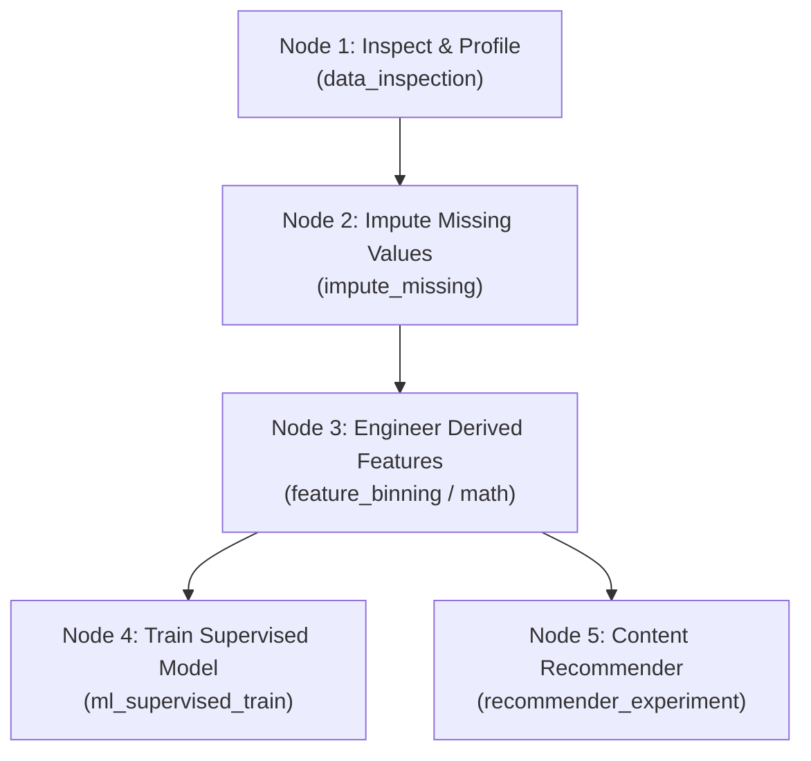

# DataLab — Interactive Data Science Platform & Netflix Strategy Case Study

[](https://www.python.org/)
[](https://streamlit.io/)
[](https://plotly.com/)
[](https://pandas.pydata.org/)
[](https://scikit-learn.org/)
[](LICENSE)

An end-to-end interactive data science platform (**DataLab**) paired with an executive domain case study on Netflix's global catalog and content licensing strategy. DataLab guides practitioners through every stage of the data science lifecycle: exploratory analysis, interactive data cleaning, visual DAG pipeline assembly, supervised modeling, recommender experimentation, and evidence-based learning missions.

Built with pure Python, **Streamlit**, **Plotly**, and **Scikit-Learn**, powered by the Kaggle Netflix catalog dataset (8,800+ records) and extensible to any user-uploaded CSV dataset.

---

## Primary Navigation & System Architecture

The application is structured into **6 canonical workspaces** navigated via an active-workspace sidebar dispatcher that renders only the currently selected workspace:

```text
├── Explore Dataset       # Phase 1: Schema profiling, missingness audit, distributions, filters
├── Clean & Transform      # Phase 2: Missingness handling, deduplication, feature engineering, audit ledger
├── Workflow Studio        # Phase 4: Visual DAG pipeline builder, stage inspection, execution engine
├── Model Lab             # Phase 3: Predictive modeling studio, recommender arena, quick recommendations
├── Missions              # Phase 4: Guided data science missions with verifiable completion evidence
└── Netflix Case Study    # Domain analytics: Executive strategy, global reach, genres, pipeline report
```

---

## Repository Structure

```text
IDSE_Project/
├── netflix_titles.csv              # Tracked canonical Kaggle Netflix catalog (8,807 titles)
├── data/
│   └── .gitkeep                    # Directory preserved for user data exports and fallbacks
├── src/
│   ├── __init__.py                 # Lightweight exports with lazy UI loading
│   ├── ui_theme.py                 # Central design system: tokens, custom CSS stylesheet & Plotly theme
│   ├── data_context.py             # Canonical dataset state, revision tracking & stale detection
│   ├── operation_registry.py       # Allowlisted operation registry, schema specs & validation rules
│   ├── data_generator.py           # Canonical dataset presence & path verification
│   ├── data_cleaner.py             # Domain data cleaning & missing value audit ledger
│   ├── data_explorer.py            # Phase 1: Core profiling, schema, missingness & filtering engine
│   ├── explorer_ui.py              # Phase 1: Streamlit UI components & visualizer
│   ├── cleaning_lab.py             # Phase 2: WorkingDatasetManager, What Changed?, JSON replay
│   ├── cleaning_lab_ui.py          # Phase 2: Cleaning & feature engineering interactive UI
│   ├── model_lab.py                # Phase 3: Supervised modeling engine, sparse TF-IDF recommender
│   ├── model_lab_ui.py             # Phase 3: Predictive Studio, Recommender Arena, Quick Recs
│   ├── workflow_engine.py          # Phase 4: Topological DAG engine, cycle detection, failure isolation
│   ├── workflow_ui.py              # Phase 4: Workflow Studio visual canvas, stage inspector & JSON hub
│   ├── missions.py                 # Phase 4: 7-mission curriculum, evidence verification & reflections
│   ├── missions_ui.py              # Phase 4: Mission Mode UI, layered hints & progress tracking
│   ├── netflix_case_study_ui.py    # Dedicated Netflix executive analytics, local slicers & insights
│   ├── feature_engineer.py         # Licensing lag, audience tiers, exploders & metadata soup
│   ├── model_trainer.py            # Legacy ContentRecommender engine with memory-safe sparse accessor
│   └── visualizations.py           # Plotly visualization engine styled with corporate dark theme
├── tests/
│   ├── __init__.py
│   ├── test_data_explorer.py       # Phase 1 unit tests (19 tests)
│   ├── test_cleaning_lab.py        # Phase 2 unit & regression tests (26 tests)
│   ├── test_model_lab.py           # Phase 3 unit & regression tests (23 tests)
│   ├── test_workflow.py            # Phase 4 Workflow Studio test suite (10 tests)
│   ├── test_missions.py            # Phase 4 Data Scientist Missions test suite (10 tests)
│   └── test_refactor_regression.py # Architecture cleanup & UI redesign test suite (5 tests)
├── notebooks/
│   └── exploratory_analysis.ipynb  # Narrative exploratory notebook
├── app.py                          # Streamlit application entry point (navigation & routing)
├── requirements.txt                # Pinned production dependencies
└── README.md                       # Comprehensive architecture & documentation
```

---

## Quickstart & Installation

### 1. Clone & Set Up Environment

```bash
git clone https://github.com/ArunodayGupta/IDSE_Project.git
cd IDSE_Project

# Create virtual environment
python -m venv venv

# Activate on Windows:
venv\Scripts\activate
# Activate on macOS/Linux:
source venv/bin/activate

# Install dependencies
pip install -r requirements.txt
```

### 2. Launch the Application

```bash
python -m streamlit run app.py
```
The application opens in your default browser at `http://localhost:8501`.

### 3. Run Automated Unit & Regression Tests

```bash
python -m unittest discover -s tests -p "test_*.py" -v
```
**All 101 automated tests run and pass cleanly** across all 6 test suites.

---

## Modern Analytics Workspace Design System (`src/ui_theme.py`)

DataLab has been completely redesigned with a cohesive, modern analytics workspace aesthetic:
- **Surface Palette:** Deep midnight-navy (`#0B0F19`) canvas with elevated dark panels (`#141C2E`, `#0E1424`) and subtle geometric borders (`#1E2B44`).
- **Accents:** Electric cyan (`#00D2FF`) and sky blue (`#38BDF8`) primary accents; restrained violet (`#818CF8`) secondary; emerald green (`#10B981`) reserved strictly for successful runs and completed missions.
- **Typography & Components:** High-contrast Inter typography, elevated metric cards with cyan top accents, status pills, and callout containers.
- **Unified Plotly Theme:** Centralized `apply_figure_theme()` ensuring all visualizations share transparent backdrops, subtle gridlines, and coordinated colors.
- **Execution Efficiency:** Replaced full-page multi-tab execution with active-workspace dispatch in `app.py`, ensuring only the selected workspace is evaluated during interaction.

---

## Four-Phase DataLab Architecture

### Phase 1:  Interactive Dataset Explorer (`src/data_explorer.py`, `src/explorer_ui.py`)
- **Dataset Source Selection:** Seamlessly switch between the built-in Kaggle Netflix catalog (8,807 rows) and custom uploaded CSVs (supporting UTF-8, Latin-1, CP1252 with BOM handling).
- **KPI Summary Scorecard:** Instant calculation of row count, column counts by logical type, duplicate rows, missing cell counts & percentages, complete rows, and deep memory footprint.
- **Five Specialized Subtabs:**
  1. *Schema & Data Dictionary:* Column data types, non-null counts, missing rates, distinct values, and sample values.
  2. *Missingness Visualizer:* Unified missingness convention (treating whitespace-only strings as missing without mutation), missingness bar charts, and sparsity matrices.
  3. *Column Distributions:* Numeric statistics (IQR, skewness, outliers via $1.5 \times \text{IQR}$), categorical frequencies, datetime timelines, and non-destructive date parsing previews.
  4. *Filter & Search Workspace:* Multi-condition filtering combining numeric ranges, categorical selections, text queries, and missingness flags with predictable `AND` logic.
  5. *Record Browser & Inspector:* Paginated tabular browsing with sorted columns and deep row-level inspection.

### Phase 2:  Clean & Transform Lab (`src/cleaning_lab.py`, `src/cleaning_lab_ui.py`)
- **Shared State Management:** The active dataset is shared canonically across workspaces using `src/data_context.py` with immutable raw source snapshots and isolated working copies.
- **Zero-Row Working Dataset Preservation:** Downstream workspaces correctly recognize and preserve legitimate cleaning operations that result in 0 rows without silently reverting to raw data.
- **Transformation Operations Registry:**
  - *Missing Values:* Drop rows (`any`/`all`), drop columns, impute with mean/median/mode, or fill with constant values (supporting falsy values like `0` or `""`).
  - *Deduplication:* Subset-based deduplication with `first`, `last`, or `none` retention policies.
  - *Type Conversion & Text Normalization:* Safe casting with error coercion, whitespace trimming, and casing transforms.
  - *Feature Engineering:* Numeric arithmetic (with zero-division protection), math transforms (`log`, `abs`), quantile/interval binning, datetime extraction, and categorical mapping.
- **"What Changed?" Differential Engine:** Quantifies altered cells within retained rows, identifies removed records, calculates per-column missingness deltas, and logs an audit ledger.
- **Deterministic Undo & Replay:** Replays configurations from the immutable raw source with transaction safety and JSON export/import.

### Phase 3:  Model Lab (`src/model_lab.py`, `src/model_lab_ui.py`)
- **Mode 1 — Predictive Modeling Studio:**
  - *Task Heuristic Detection:* Auto-suggests classification or regression based on target cardinality and data types.
  - *Leakage-Free Preprocessing:* Scikit-Learn `ColumnTransformer` fitted strictly on training splits. Categorical features are encoded via `OneHotEncoder(sparse_output=True, handle_unknown="ignore")` with cardinality guards.
  - *Candidate Model Suite:*
    - Classification: `DummyClassifier` (baseline), `LogisticRegression`, `DecisionTreeClassifier`, `RandomForestClassifier`.
    - Regression: `DummyRegressor` (baseline), `Ridge`, `DecisionTreeRegressor`, `RandomForestRegressor`.
  - *Comprehensive Validation:* Evaluates accuracy, macro F1, weighted F1, precision, recall, confusion matrix, per-class metrics, MAE, RMSE, and $R^2$.
  - *Configuration Fingerprinting:* Computes deterministic SHA-256 fingerprints across dataset identity, target column, feature list, split ratios, random seed, cross-validation settings, and hyperparameters. Changes immediately invalidate or mark old results as historical.
  - *Small-Dataset Guards:* Actionable warnings for single-class targets, insufficient samples per class for stratification, and incompatible cross-validation fold counts.
- **Mode 2 — Recommender Experiment Arena:**
  - *Memory-Safe Sparse TF-IDF:* On-demand sparse dot products (`cosine_similarity(query_vec, catalog_matrix)`) replace dense $N \times N$ allocations.
  - *Multi-Field Weighting & Ablation:* Allows users to configure field weights, n-gram ranges, sublinear TF, and stop words.
  - *A/B Query Comparisons:* Side-by-side evaluation calculating Jaccard overlap, rank shifts, and entering/leaving items.
  - *Truthful Relevance Metrics:* Feedback is keyed by `(dataset_id, title_col, query_title)`. Reports **relevance rate among judged recommendations** with the exact denominator displayed (`X / Y judged`), alongside documented partial NDCG.
- **Mode 3 — Quick Netflix Recommendations:**
  - Direct title lookup using the legacy recommendation algorithm paired with modern glassmorphism recommendation cards displaying match percentages, metadata tokens, and synopses.

---

## Phase 4: Visual Workflow Studio (`src/workflow_engine.py`, `src/workflow_ui.py`)

Workflow Studio allows practitioners to assemble, configure, execute, and inspect complete data science pipelines as a directed acyclic graph (DAG).



### 1. Reusable Step Palette
- **Data Ingestion & Hygiene:** Active dataset inspection, column profiling, and schema validation.
- **Cleaning & Transformation:** Missing value dropping/imputation, deduplication, type conversion, and text normalization.
- **Feature Engineering:** Arithmetic combinations, mathematical transforms, binning, datetime extraction, and Netflix recipes.
- **Machine Learning & Evaluation:** Target selection, train/test split, estimator configuration, metric evaluation, and residual/confusion matrix diagnostics.
- **Recommender Experiments:** Metadata selection, TF-IDF tuning, and top-$K$ semantic similarity ranking.

### 2. DAG Engine & Execution Guarantees
- **Topological Sorting:** Steps execute in strict dependency order ($Kahn's$ algorithm).
- **Cycle & Dependency Validation:** Automatically detects cyclic references or missing upstream node IDs before execution.
- **Failure Isolation & Invalidation:** If an upstream step fails, execution halts safely, the error is recorded on that node, and downstream steps transition to `invalidated` without corrupting valid upstream results.
- **Downstream Modification Invalidation:** Editing a node's configuration automatically invalidates its cached output and all downstream steps.
- **Stage Inspection ("What Changed?"):** Each completed node displays exact row/column deltas, affected features, execution runtime, and intermediate DataFrame previews.

### 3. Versioned Workflow JSON Serialization & Safety
- **Strict Allowlisting:** Workflows serialize to versioned JSON (`schema_version: 1.0.0`).
- **Zero Arbitrary Code Execution:** Absolutely **no** `eval()`, `exec()`, or dynamic code execution. All imported operations are validated against `src/operation_registry.py`.

---

## Phase 4: Data Scientist Mission Mode (`src/missions.py`, `src/missions_ui.py`)

A guided learning track consisting of **7 progressive, evidence-based missions**:

| Mission | Title | Learning Objective | Verifiable Evidence Required |
| :---: | :--- | :--- | :--- |
| **1** | **Investigate the Dataset** | Inspect schema, missingness, and anomalous values | Recorded session exploration interaction in `Explore Dataset` |
| **2** | **Clean Without Losing Data** | Handle missing/duplicate values without excessive loss | Executed cleaning step with recorded "What Changed" delta in manager or workflow |
| **3** | **Engineer a Useful Feature** | Create derived features (binning, math, date extract) | Verified derived column added to active working dataset or workflow |
| **4** | **Train a Baseline Model** | Train dummy baseline and candidate estimator on identical split | Evaluated baseline vs. candidate model scores recorded in `Model Lab` |
| **5** | **Diagnose Model Performance** | Analyze error patterns, misclassifications, and residuals | Inspected confusion matrix or regression residual error distribution |
| **6** | **Experiment With Recommendations** | Multi-field weighting and similarity vs. relevance | Executed recommender experiment with ranked output and recorded relevance feedback |
| **7** | **Build & Reproduce a Workflow** | Assemble, execute, and export an end-to-end DAG pipeline | Completed multi-step workflow execution with recorded runtime and JSON configuration |

### Guided Pedagogy
- **Layered Hints:**
  1. *Level 1 (Concept):* Core data science principles and trade-offs.
  2. *Level 2 (Dataset Context):* Specific guidance tailored to the active dataset schema.
  3. *Level 3 (Walkthrough):* Exact step-by-step instructions.
- **Interactive Knowledge Checks:** Conceptual reflection questions with immediate feedback.
- **Schema-Aware Adaptation:** Missions dynamically verify dataset column prerequisites. For example, Netflix-specific missions require relevant catalog columns; generic missions adapt to arbitrary uploaded CSVs.

---

## Netflix Content Strategy Case Study (`src/netflix_case_study_ui.py`, `src/visualizations.py`)

Retained as a dedicated executive case study analyzing Netflix's transformation into a global streaming powerhouse:

1. **Executive Strategy & Growth:**
   - **Catalog Expansion Velocity:** Tracks annual volume additions split by Movies and TV Shows.
   - **Studio Defense Pivot:** Quantifies the shift from studio licensing (>3-year lag) to in-house Originals and same-year releases.
2. **Global Distribution & Catalog Reach:**
   - Geographic production distribution across 14+ producing nations.
   - Rating tier localization comparing Western mature titles with family/co-viewing titles in emerging markets.
3. **Format & Genre Composition:**
   - Feature film runtime sweet spot (median 98–104 minutes).
   - The TV "Season 2 Cliff" (>80% of series do not survive past Season 2).
   - Genre co-occurrence correlation matrix.
4. **Pipeline Report & Data Quality:**
   - **The Missing Director Hypothesis:** Empirically demonstrates that high director null rates are structural to episodic television (~74% missing) compared to feature films (<12% missing).

---

## Testing, Quality & Regression Verification

Automated tests are located in `tests/`:

```bash
# Run all test suites
python -m unittest discover -s tests -p "test_*.py" -v

# Run individual suites
python -m unittest tests/test_data_explorer.py -v
python -m unittest tests/test_cleaning_lab.py -v
python -m unittest tests/test_model_lab.py -v
python -m unittest tests/test_workflow.py -v
python -m unittest tests/test_missions.py -v
python -m unittest tests/test_refactor_regression.py -v
```

### Verified Regressions & Defect Fixes:
- **A1:** Zero-row working datasets are preserved correctly and do not silently fall back to raw data.
- **A2:** Dataset identity changes immediately invalidate stale model and recommender outputs.
- **A3:** Model configuration fingerprinting invalidates displayed results when targets, features, splits, or hyperparameters change.
- **A4:** Memory-conscious sparse one-hot encoding replaces dense arrays with cardinality guards.
- **A5:** Versioned JSON serialization for predictive and recommender experiments.
- **A6:** Recommender feedback keyed by `(dataset_id, title_col, query_title)` with truthful relevance rates.
- **A7:** Deduplicated session experiment tracking with individual deletion.
- **A8:** Actionable warnings for rare classes, single-class targets, and small sample splits.

---

## Known Technical Limitations & Modeling Caveats

1. **Same-Year Acquisition Lag as a Proxy:**
   - Calculating `acquisition_lag = year_added - release_year == 0` is an operational proxy for day-and-date or in-house releases. It does **not** prove a causal business strategy or establish formal intellectual property ownership.
2. **Recommender Relevance vs. Ground Truth:**
   - TF-IDF cosine similarity measures text and metadata similarity, not user satisfaction. Ranking metrics (Precision@K, NDCG@K) require explicit human judgments; unjudged catalog items are not artificially treated as negative labels.
3. **Local In-Memory Architecture:**
   - DataLab is designed for local, single-node exploratory data science. It operates on in-memory Pandas DataFrames and does not require external databases, cloud services, or paid external LLM APIs.
