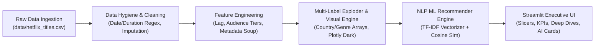

# 🎬 Netflix Content Strategy & Catalog EDA

[](https://www.python.org/)
[](https://streamlit.io/)
[](https://plotly.com/)
[](https://pandas.pydata.org/)
[](LICENSE)

An executive-level **Exploratory Data Analysis (EDA) and Business Intelligence web application** investigating Netflix's transition from a studio DVD/digital syndication model into a vertically integrated, global streaming hegemon.

Built with a modular Python pipeline, interactive **Plotly** visualizations, and an executive **Streamlit** dashboard powered by the official 8,800+ title Kaggle Netflix catalog dataset.

---

## 📌 Executive Summary & Core Business Findings

| Strategic Question | Executive Takeaway | Data Evidence |
| :--- | :--- | :--- |
| **1. The Studio Defense Pivot** | Early Netflix depended on legacy studio licensing. In anticipation of Disney+, Peacock, and HBO Max withdrawing back-catalogs, Netflix aggressively transitioned capital into **in-house Originals** and same-year exclusive releases. | Pre-2016 acquisitions were dominated by back-catalogs (**>3 yr lag: 55%+**). By 2021+, same-year releases (**lag = 0**) surged to **over 50%** of all additions. |
| **2. Feature Film Sweet Spot** | Film runtimes are strictly clustered around **90–110 minutes**. Streaming algorithms maximize completion rates (reducing drop-off) and optimize ad-insertion inventory. | Median movie runtime is **98–104 minutes**, with sharp drop-offs for runtimes exceeding 130 minutes. |
| **3. The TV "Season 2 Cliff"** | Series face an aggressive culling rate due to Netflix's cost-plus talent agreements and declining marginal subscriber acquisition per season. | **>60%** of TV series conclude after Season 1; **>80%** do not survive past Season 2. |
| **4. Global Localization Dynamics** | Expansion into India, UK, and South Korea requires customized content rating distributions. Western markets skew mature; emerging markets skew family/teen. | US/UK catalogs skew heavily toward **Mature / Adults (TV-MA, R)**, while India features significantly higher **Family / Teens (TV-14, TV-PG)** co-viewing titles. |
| **5. The "Missing Director" Hypothesis** | High missing director rates in streaming catalogs are **structural** to the medium of episodic TV, rather than poor data collection. | TV Shows exhibit **~74% null director rates** (due to showrunners and rotating episodic directors), whereas Movies exhibit **<12% null rates**. |

---

## 🏗️ System Architecture & Engineering Rigor

```text
netflix-content-strategy-eda/
├── data/
│   ├── .gitkeep
│   └── netflix_titles.csv          # Official Kaggle dataset (8,800+ titles)
├── src/
│   ├── __init__.py                 # Clean package exports
│   ├── data_generator.py           # Robust dataset presence & path verification
│   ├── data_cleaner.py             # Missing value audit, string parsing & hypothesis testing
│   ├── data_explorer.py            # DataLab Phase 1 core profiling, schema, missingness & filtering engine
│   ├── explorer_ui.py              # DataLab Phase 1 Streamlit UI components & visualizer
│   ├── feature_engineer.py         # Licensing lag, audience tiering, multi-label exploders & metadata soup
│   ├── model_trainer.py            # TF-IDF & Cosine Similarity NLP Content Recommender
│   └── visualizations.py           # Plotly chart engine with bespoke corporate styling
├── tests/
│   ├── __init__.py
│   └── test_data_explorer.py       # Automated unit test suite (20 comprehensive tests)
├── notebooks/
│   └── exploratory_analysis.ipynb  # Step-by-step narrative Jupyter notebook
├── app.py                          # Streamlit executive dashboard & DataLab workspace
├── requirements.txt                # Pinned production dependencies
└── README.md                       # Strategic documentation & portfolio case study
```

### The 5 Pipeline Phases



1. **Phase 1: Ingestion & Dataset Verification (`src/data_generator.py`)**
   - Validates that `data/netflix_titles.csv` is present in the `data/` directory.
   - Raises informative `FileNotFoundError` if missing, guaranteeing reproducible pipeline execution.

2. **Phase 2: Data Hygiene & Parsing Pipeline (`src/data_cleaner.py`)**
   - Generates a quantitative **Missing Value Audit Ledger** before and after cleaning.
   - Tests and quantifies the **Missing Director Hypothesis** (TV vs. Movie null comparisons).
   - Standardizes `date_added` into parsed datetime and extracts `year_added`, `month_added`, and `month_name`.
   - Parses `duration` via regex into `duration_min` (Movies only) and `seasons_count` (TV Shows only).

3. **Phase 3: Strategic Feature Engineering (`src/feature_engineer.py`)**
   - **Acquisition Lag (`acquisition_lag`):** Calculated as `year_added - release_year` (clipped at min 0).
   - **Content Origin Proxy (`content_origin_proxy`):** Segmented into `Same-Year (Original/Exclusive Proxy)`, `Recent Release (1-3 Yrs)`, and `Back-Catalog (>3 Yrs)`.
   - **Audience Maturity Tier (`audience_tier`):** Maps 10+ TV/MPAA ratings into 3 clean business tiers: *Kids*, *Family / Teens*, and *Mature / Adults*.
   - **Multi-Label Relational Exploder (`explode_column`):** Splits comma-separated strings (`country`, `listed_in`) to enable granular geographic and genre co-occurrence counting without mutating or duplicating rows in the parent DataFrame.

4. **Phase 4: Plotly Visualization Engine (`src/visualizations.py`)**
   - Bespoke Netflix Dark Design System (`#E50914` primary red, `#141414` background, translucent hover cards).
   - Five interactive figures:
     1. `plot_catalog_growth`: Catalog volume velocity and TV vs. Movie pivot.
     2. `plot_acquisition_lag_trend`: 100% normalized stack of the studio defense pivot.
     3. `plot_top_countries_audience`: Horizontal stacked bar of top producing nations by audience tier.
     4. `plot_genre_cooccurrence`: 2D pairwise correlation heatmap of co-occurring genres.
     5. `plot_duration_distributions`: Side-by-side subplots of movie runtime sweet spots and TV season drop-offs.
     6. `plot_missing_directors_comparison`: Visual proof of episodic TV director dispersion.

---

## 🚀 Quickstart & Installation

### 1. Clone & Set Up Virtual Environment

```bash
git clone https://github.com/your-username/netflix-content-strategy-eda.git
cd netflix-content-strategy-eda

# Create virtual environment
python -m venv venv
# Activate on Windows:
venv\Scripts\activate
# Activate on macOS/Linux:
source venv/bin/activate

# Install dependencies
pip install -r requirements.txt
```

### 2. Launch the Streamlit Executive Dashboard

```bash
streamlit run app.py
```
*Or using the Python module:*
```bash
python -m streamlit run app.py
```
The interactive dashboard will open automatically in your browser at `http://localhost:8501`.

### 3. (Optional) Run the Narrative Jupyter Notebook

```bash
jupyter notebook notebooks/exploratory_analysis.ipynb
```

---

## 📊 Kaggle Dataset Integration

The dashboard permanently connects to the official Kaggle dataset: **[Netflix Movies and TV Shows by Shivam Bansal](https://www.kaggle.com/datasets/shivamb/netflix-shows)**.

The full dataset of **8,807 titles** is placed at `data/netflix_titles.csv`. The data pipeline validates and loads this catalog automatically upon application startup.

---

## 🔬 DataLab — Phase 1: Interactive Dataset Explorer

Phase 1 transforms this project from a static dashboard into an interactive exploratory data science workspace called **DataLab**. Users can dynamically inspect schema quality, investigate column distributions, detect anomalies, filter records, inspect individual rows, and export findings.

### 1. Launching the Application

Run the application from the repository root:
```bash
streamlit run app.py
```
Or via the Python module:
```bash
python -m streamlit run app.py
```
The application will launch at `http://localhost:8501`. Navigate to the primary tab: **`🔬 DataLab: Explore Dataset`**.

### 2. Dataset Source Selection & Loading
The explorer supports two isolated data modes:
* **Option A: Built-in Netflix Catalog (8,807 titles)** — Resolves the verified Kaggle catalog from `data/netflix_titles.csv` or root fallbacks relative to the project root.
* **Option B: Upload Custom CSV** — Allows users to upload their own CSV file via `st.file_uploader`.
  * **Encoding Robustness:** Automatically tries `UTF-8 with BOM (utf-8-sig)`, `UTF-8`, `Latin-1 (ISO-8859-1)`, and `CP1252 (Windows-1252)`.
  * **Edge Case Handling:** Safely handles empty/0-byte files, duplicate column headers, wide datasets (>100 columns), and mixed data types with clear user-facing alerts.
  * **Session Isolation:** Uploaded data remains strictly session-local. Uploading a custom dataset never overwrites files on disk or corrupts the legacy Netflix analytical models.

### 3. Dataset Overview Dashboard & Metrics
When a dataset is loaded, dynamic KPI cards present actual calculations:
* **Row Count:** Displays current active count with indicator if filters are active (e.g. `Filtered from 8,807 total rows`).
* **Columns:** Total column count with logical type breakdown (`Numeric`, `Categorical/Text`, `Datetime`, `Boolean`).
* **Duplicate Rows:** Quantifies identical duplicate records across all columns.
* **Missing Cells:** Total missing cells and overall dataset missingness percentage.
* **Complete Rows:** Count and percentage of records containing zero missing values.
* **Memory Usage:** Precise deep memory consumption formatted in KB/MB.

### 4. Interactive Exploration Subtabs

1. **📋 Column Schema & Data Dictionary:**
   * Interactive table detailing Column Name, Logical Type, Pandas DataType, Non-Null Count, Missing Count, Missing %, Distinct Values, and representative non-null Sample Values.
   * Search box to filter columns by name for wide datasets.
   * Direct download button for the column profiling report (`CSV`).

2. **🔍 Missing-Value Audit & Visualizer:**
   * **Missingness Convention:** Includes a toggle to *"Treat empty or whitespace-only strings as missing"* (enabled by default). This treats `""`, `"   "`, and standard nulls consistently without mutating source data.
   * **Missing Value Rankings:** Columns ordered descending by missing count and percentage with severity badges (`Critical >50%`, `High >20%`, `Moderate >0%`, `Zero Missing`).
   * **Missingness Bar Chart:** Interactive Plotly bar chart visualizing missing percentages per feature.
   * **Sparsity Matrix Heatmap:** 2D heatmap showing missing (red) vs. present (blue) cells across the dataset.
   * **Inspect Missing Records:** Drill-down table to isolate records with missing values in any selected column.

3. **📊 Column Distributions & Deep Dive:**
   * **Numeric Columns:** Non-missing count, Mean, Median, Std Dev, Min, Max, Quartiles (Q1, Q3), IQR, Skewness, Zeros count, and Outlier detection via standard `1.5 * IQR` rule. Configurable histogram bins slider and outlier box plot.
   * **Categorical/Text Columns:** Unique count, Top Category share %, configurable Top-N category slider (5–50), interactive horizontal frequency bar chart, frequency data table, and interactive record inspector for selected categories.
   * **Datetime Columns:** Valid dates count, earliest date, latest date, time span in days, and yearly timeline frequency chart.
   * **Non-Destructive Date Preview:** Preview date parsing on text columns without mutating original series.

4. **🔎 Filter & Search Workspace:**
   * **Deterministic AND Logic:** Multiple filters combine predictably with AND logic.
   * **Global Search:** Case-insensitive substring query across text fields.
   * **Numeric Range Filtering:** Min-max range sliders for any numeric column.
   * **Categorical Selection:** Multi-select filtering with search support.
   * **Text Substring:** Specific column substring queries.
   * **Missingness Filtering:** Filter by rows that are missing or non-missing in a selected column, or rows with any missing cell.
   * **Reset Action:** `🔄 Reset All Filters` button restores the full dataset view without resetting dataset source selection.

5. **📑 Record Browser & Inspector:**
   * Paginated record table with configurable page size (25, 50, 100 rows).
   * Column visibility multi-selector to choose displayed attributes.
   * Sort by any column in Ascending or Descending order.
   * **Individual Record Inspector:** Select any record from the displayed page to inspect every attribute in full detail with formatted nulls (`[Missing / Null]`).

### 5. Export Functionality
* **Filtered Data Export (CSV):** Downloads all currently filtered records (not just the visible page) with original column order, excluding internal helper columns (`index=False`).
* **Data Profile Report Export (CSV):** Downloads the complete column schema data dictionary.

### 6. Intentional Performance Limits
To keep the application responsive across large catalogs:
* The Missingness Sparsity Matrix systematically samples up to 500 rows evenly spaced across the dataset when total rows exceed 500.
* Categorical multiselect dropdowns cap option lists at the top 50 distinct categories to prevent browser latency on high-cardinality columns.
* Plotly visualizations leverage native container sizing and WebGL acceleration where available.

### 7. Running Automated Tests
Run the comprehensive automated unit test suite from the project root:
```bash
python -m unittest discover -s tests -p "test_*.py" -v
```
All 20 unit tests validate source resolution, encodings, missingness masks, schema profiling, distribution stats, filter combinations, pagination, and data isolation.

---

## 📊 Dashboard Tour

### Tab 0: 🔬 DataLab: Explore Dataset
Interactive data exploration workspace for schema profiling, missingness visualizers, column distributions, multi-condition filtering, record inspection, and CSV exports.

### Tab 1: 📈 Executive Strategy & Growth
- **Catalog Expansion Velocity:** Tracks yearly title additions split by Movies vs. TV Shows, revealing the post-2016 inflection point.
- **The Studio Defense Pivot:** 100% normalized view showing the transition from studio back-catalogs to original/same-year releases.
- **Annual Ingestion Ledger:** Quantitative summary table of volume, TV share %, and Originals proxy %.

### Tab 2: 🌍 Global Footprint & Ratings
- **Production Powerhouses:** Top 14 producing nations segmented by audience maturity tiers (*Kids*, *Family / Teens*, *Mature / Adults*).
- **International Content Strategy Matrix:** Highlights localization differences between Western markets and emerging high-growth regions like India and South Korea.

### Tab 3: 🎭 Genre & Format Mechanics
- **Runtime Optimization:** Movie runtime distribution showing the median and the 90–110 min sweet spot.
- **The Season 2 Cliff:** TV season attrition rates illustrating the financial dynamics behind series cancellations.
- **Genre Co-Occurrence Heatmap:** 2D matrix identifying which content categories are most frequently packaged together.

### Tab 4: 🛠️ EDA Data Hygiene & Engineering Log
- **Hygiene KPI Scorecard:** Initial row count, final cleaned count, and dropped anomaly rate (<1.5%).
- **Missing Director Hypothesis Deep Dive:** Interactive visual and statistical proof explaining episodic TV director attribution.
- **Missing Value Audit Ledger:** Comprehensive before-and-after table tracking null counts and percentages across all features.
- **Cleaned Data Explorer & CSV Export:** Interactive table with one-click export for downstream modeling.

### Tab 5: 🤖 AI Recommender Engine
- **NLP Metadata Soup Construction:** Blends lowercased titles, sanitized director/cast name tokens (`Tom Hanks` -> `tomhanks`), genre categories, and descriptions.
- **TF-IDF & Cosine Similarity Matrix:** Scikit-Learn vectorizer (5,000 max features, English stop words) generating high-dimensional semantic embeddings.
- **Interactive Title Search & Slicer Integration:** Instant query lookup across the active catalog slice with dedicated target spotlight.
- **Bespoke Visual Recommendation Cards:** High-end glassmorphism containers showcasing similarity match %, format, rating, metadata tokens, and narrative synopses.

---

## 🛠️ Tech Stack & Dependencies

* **Language:** Python 3.10+
* **Data Processing & Manipulation:** `pandas>=2.0.0`, `numpy>=1.24.0`
* **Machine Learning & NLP:** `scikit-learn>=1.3.0` (TF-IDF Vectorizer, Cosine Similarity)
* **Interactive Visualization:** `plotly>=5.18.0`
* **Web Application Framework:** `streamlit>=1.30.0`
* **Statistical Modeling & Distribution:** `scipy>=1.11.0`

---
