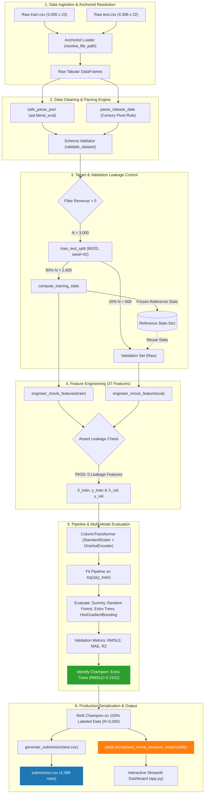

# DataLab: Predictive Modeling of Worldwide Theatrical Box Office Revenue from Pre-Release Metadata

**Course:** Introduction to Data Science and Engineering (IDSE)  
**Project Title:** DataLab — Movie Box Office Worldwide Revenue Prediction Platform  
**Dataset:** TMDB (The Movie Database) Box Office Prediction (Kaggle)  
**Author:** Arunoday Gupta  
**Date:** November 2026  

---

## Abstract
Accurate pre-release forecasting of theatrical box-office revenue is a critical decision-support capability for film studios, distribution executives, streaming acquirers, and institutional entertainment financiers. Film production represents a high-risk capital expenditure venture characterized by substantial upfront capital commitments, multi-year production cycles, and extreme revenue volatility spanning eight orders of magnitude. 

This report presents **DataLab**, a principled, end-to-end Data Science and Engineering pipeline developed on the Kaggle TMDB Box Office Prediction dataset ($N = 3,000$ training records, $N = 4,398$ unlabelled test records). We formulate revenue prediction as a supervised regression task on log-transformed returns $z = \log(1 + y)$ to stabilize exponential variance across long-tailed blockbuster distributions. 

Our pipeline enforces rigorous **pre-release causal constraints** by systematically excluding post-release audience signals (`popularity`, `vote_average`, `vote_count`) and database identifiers (`id`, `imdb_id`, `poster_path`) to prevent target leakage. To prevent preprocessing data leakage, all feature imputation and scaling statistics are derived strictly from the training partition ($80\%$, $N = 2,400$) and reused on validation ($20\%$, $N = 600$) and test sets. 

We engineer 37 pre-release features spanning financial, temporal, genre, talent attachment, studio caliber, and marketing metadata. Across four diverse regression architectures—Dummy Baseline, Random Forest Regressor, Extra Trees Regressor, and Histogram-based Gradient Boosting Regressor—the **Extra Trees Regressor** achieved superior validation performance with a Root Mean Squared Logarithmic Error (**RMSLE**) of **2.2152**, a Mean Absolute Error (**MAE**) of **\$48,515,649**, and a coefficient of determination (**$R^2$**) of **0.4907**. 

The end-to-end system is integrated into a multi-section **Streamlit** analytical dashboard featuring interactive KPI telemetry, longitudinal trends, reproducible data exploration, real-time single-movie inference with boundary warnings, and an automated Kaggle submission generator.

---

## 1. Introduction

### 1.1 Problem Statement & Industrial Motivation
The motion picture industry operates under an economic model characterized by asymmetric downside risk and winner-take-all upside dynamics. Mainstream studio theatrical productions routinely demand capital investments ranging from \$30 million to over \$300 million for physical production, with supplemental print and advertising (P&A) marketing budgets frequently matching or exceeding production budgets. Crucially, these financial investments are committed between 18 and 36 months before the public release of the film, at which point box-office reception is determined within the first one to three theatrical weekends.

Traditional studio greenlighting decisions have historically relied on executive intuition, qualitative script coverage, and comparative historical titles. Data-driven theatrical revenue prediction provides an empirical risk-management tool. By leveraging pre-release metadata available prior to public exhibition, statistical machine learning enables:
1. **Capital Budget Optimization:** Assessing whether incremental budget allocations yield commensurate expected box-office multiples.
2. **Release Calendar Scheduling:** Determining optimal theatrical release windows (e.g., summer blockbuster season vs. fourth-quarter holiday corridors) based on historical seasonal performance.
3. **Distribution & Screen Booking Strategy:** Aiding domestic and international theatrical bookers in negotiating minimum screen guarantees and exhibition splits.

### 1.2 Mathematical Formulation
We formulate box-office prediction as a **supervised continuous regression task**:

$$\hat{y} = f(\mathbf{x}; \boldsymbol{\theta})$$

where:
* $\mathbf{x} \in \mathbb{R}^d$ represents a $d$-dimensional pre-release feature vector ($d = 37$).
* $y \in \mathbb{R}^+$ represents the continuous ground-truth worldwide box-office gross in United States Dollars (`revenue`).
* $f(\cdot; \boldsymbol{\theta})$ denotes a parameterized predictive hypothesis function learned over training samples $\mathcal{D}_{\text{train}} = \{(\mathbf{x}_i, y_i)\}_{i=1}^n$.

### 1.3 Target Transformation: Why $\log(1 + y)$?
Worldwide theatrical box office in the TMDB corpus exhibits severe positive skewness, with observed revenues ranging from nominal sums (\$1) to record-shattering tentpoles exceeding \$1.5 billion. The distribution follows a heavy-tailed, Pareto-like power law where the mean (\$66.7M) dramatically exceeds the median (\$16.8M).

Directly fitting linear or distance-based estimators on raw dollar revenues introduces severe gradient pathology: loss gradients during optimization are overwhelmingly dominated by the top $1\%$ of billion-dollar outliers, causing models to underfit the vast majority of low- and mid-budget films. Furthermore, theatrical revenue cannot be negative ($y \ge 0$). 

To normalize the conditional distribution and stabilize variance, we apply the natural logarithmic transformation:

$$z = \log(1 + y) = \text{log1p}(y)$$

All models are trained to optimize errors in log-revenue space. During inference, predicted log-values $\hat{z}$ are mapped back to non-negative dollar amounts using the natural exponential inverse function:

$$\hat{y} = \max\left(0, \exp(\hat{z}) - 1\right) = \max\left(0, \text{expm1}(\hat{z})\right)$$

### 1.4 Evaluation Metrics
In alignment with the official Kaggle TMDB Box Office Prediction competition, our primary objective metric is **Root Mean Squared Logarithmic Error (RMSLE)**:

$$\text{RMSLE}(y, \hat{y}) = \sqrt{\frac{1}{n} \sum_{i=1}^n \left(\log(1 + \hat{y}_i) - \log(1 + y_i)\right)^2}$$

RMSLE penalizes relative percentage errors equally across both small indie films and massive blockbusters. An under-prediction of \$10M on a \$20M movie incurs the same logarithmic penalty as an under-prediction of \$100M on a \$200M movie.

To provide direct financial interpretability for studio stakeholders, we report secondary metrics:
* **Mean Absolute Error (MAE):** The average absolute dollar error:
  $$\text{MAE} = \frac{1}{n} \sum_{i=1}^n |y_i - \hat{y}_i|$$
* **Coefficient of Determination ($R^2$):** The proportion of variance in actual revenue explained by the model:
  $$R^2 = 1 - \frac{\sum_{i=1}^n (y_i - \hat{y}_i)^2}{\sum_{i=1}^n (y_i - \bar{y})^2}$$

### 1.5 Causal Pre-Release Constraints & Scope
A fundamental engineering requirement of this project is **strict adherence to pre-release causality**. In predictive analytics, data leakage occurs when features containing information about the target variable or post-event signals are improperly provided to the model during training.

The TMDB dataset contains features that are updated continuously *after* theatrical release:
* `vote_average` (average user rating on TMDB)
* `vote_count` (total number of user reviews submitted)
* `popularity` (a dynamic metric computed from daily page views, search frequency, and user bookmarks)

Including these features would constitute catastrophic data leakage, turning the project from an authentic pre-release forecasting system into a post-release popularity calibration tool. Our project strictly enforces the exclusion of all post-release signals, identifiers (`id`, `imdb_id`, `poster_path`), and unstructured text summaries (`overview`). Only attributes known before opening weekend are admitted into the feature pipeline.

---

## 2. Data Collection

### 2.1 Dataset Provenance & Collection Methodology
The dataset utilized in this research is sourced from the official Kaggle **TMDB Box Office Prediction Competition**, compiled via the open API of **The Movie Database (TMDB)**. TMDB is an open, crowd-sourced cinematic metadata repository tracking historical and contemporary global film releases.

The competition benchmark provides two canonical tabular partitions:
1. **Training Dataset (`train.csv`):** 3,000 motion pictures released across global markets between 1921 and 2018, containing full metadata and verified ground-truth worldwide box-office revenue (`revenue`).
2. **Testing Dataset (`test.csv`):** 4,398 unlabelled motion pictures. The target variable `revenue` is withheld for competition leaderboard evaluation.
3. **Sample Submission (`sample_submission.csv`):** Format specification mapping movie `id` to predicted `revenue`.

### 2.2 Raw Dataset Schema & Structural Audit
The raw training set comprises 3,000 rows and 23 heterogeneous columns. The features and their structural descriptions are itemized in Table 1.

| Column Name | Storage Type | Null Count | Null % | Description & Structural Format | Pre-Release Admissibility |
| :--- | :--- | :---: | :---: | :--- | :--- |
| `id` | Integer | 0 | 0.00% | Unique internal dataset record identifier | Excluded (Arbitrary Key) |
| `belongs_to_collection` | String (JSON) | 2,396 | 79.87% | Stringified dictionary of franchise details (`id`, `name`, `poster_path`) | **Admitted (Pre-release franchise)** |
| `budget` | Integer/Float | 0 | 0.00% | Declared physical production budget in USD (contains zero sentinels) | **Admitted (Primary financial feature)** |
| `genres` | String (JSON) | 7 | 0.23% | List of stringified JSON objects (`id`, `name`) | **Admitted (Core creative metadata)** |
| `homepage` | String (URL) | 2,054 | 68.47% | Official studio marketing website URL | **Admitted (Marketing flag)** |
| `imdb_id` | String | 0 | 0.00% | External Internet Movie Database alphanumeric identifier | Excluded (Identifier) |
| `original_language` | String | 0 | 0.00% | Two-letter ISO 639-1 language code of primary audio | **Admitted (Categorical)** |
| `original_title` | String | 0 | 0.00% | Film title in original language | Excluded (High cardinality text) |
| `overview` | String | 8 | 0.27% | English textual synopsis/plot summary | Excluded (Unstructured text) |
| `popularity` | Float | 0 | 0.00% | Dynamic TMDB user interaction index | **EXCLUDED (Target Leakage)** |
| `poster_path` | String | 1 | 0.03% | Filename path of official promotional key art | Excluded (Asset path) |
| `production_companies` | String (JSON) | 156 | 5.20% | List of stringified JSON objects of production entities | **Admitted (Studio tier signal)** |
| `production_countries` | String (JSON) | 157 | 5.23% | List of stringified JSON objects with ISO 3166-1 country codes | **Admitted (Geographic origin)** |
| `release_date` | String | 0 | 0.00% | Date of initial public theatrical exhibition (`MM/DD/YY` or `YYYY-MM-DD`) | **Admitted (Temporal feature)** |
| `runtime` | Float | 2 | 0.07% | Total theatrical duration in minutes | **Admitted (Continuous physical)** |
| `spoken_languages` | String (JSON) | 20 | 0.67% | List of stringified JSON objects of spoken languages | **Admitted (Linguistic diversity)** |
| `status` | String | 0 | 0.00% | Release status (`Released`, `Rumored`) | Excluded (Post-release state) |
| `tagline` | String | 597 | 19.90% | Promotional marketing slogan | **Admitted (Marketing effort flag)** |
| `title` | String | 0 | 0.00% | Official English theatrical release title | Excluded (High cardinality) |
| `Keywords` | String (JSON) | 276 | 9.20% | List of thematic plot keyword tags | Excluded (High cardinality) |
| `cast` | String (JSON) | 13 | 0.43% | Ordered list of JSON objects of actors, roles, and cast IDs | **Admitted (Ensemble cast size)** |
| `crew` | String (JSON) | 16 | 0.53% | List of JSON objects of directors, producers, crew roles | **Admitted (Crew attachment size)** |
| `revenue` | Float | 0 | 0.00% | Worldwide box-office theatrical gross in USD | **TARGET VARIABLE ($y$)** |

---

## 3. Data Preprocessing

Data preprocessing bridges raw, noisy, semi-structured data and structured mathematical feature matrices. Motion picture metadata presents unique preprocessing challenges: stringified JSON dictionaries, unrecorded financial sentinels, ambiguous date pivots, and severe missingness.

```
+-------------------------------------------------------------------------+
|                  DATA PREPROCESSING & PARSING STAGE                     |
+-------------------------------------------------------------------------+
|  [Raw Data Input]                                                       |
|       |                                                                 |
|       v                                                                 |
|  [Safe JSON Parser] ──> ast.literal_eval() with json.loads fallback     |
|       |                 Safely decodes single-quoted nested dicts       |
|       v                                                                 |
|  [Date Parser]      ──> Strict 2-digit century pivot (>2020 -> 1900s)   |
|       |                 Preserves explicit 4-digit ISO dates            |
|       v                                                                 |
|  [Zero Sentinels]   ──> Detects budget <= 0 (27.07% missingness)        |
|       |                 Creates budget_is_zero binary indicator         |
|       v                                                                 |
|  [Leak-Free Split]  ──> 80% Train / 20% Validation Partition            |
|                         Stats computed SOLELY on train and cached       |
+-------------------------------------------------------------------------+
```

### 3.1 Robust JSON Parsing (`safe_parse_json`)
In the TMDB dataset, columns containing structured metadata (`genres`, `production_companies`, `cast`, `crew`) are stored as serialized strings. Notably, they utilize Python single-quoted syntax (e.g., `[{'id': 28, 'name': 'Action'}]`) rather than valid RFC 8259 JSON syntax (which strictly requires double quotes). Standard Python `json.loads()` raises a `JSONDecodeError` on single quotes.

To ensure deterministic, failure-free parsing, we developed `safe_parse_json()`:
1. **Type Inspection:** Checks if the input is already a native Python `list`, `dict`, or `tuple` before evaluating missingness, avoiding `truth value of an array is ambiguous` errors in pandas.
2. **Missingness Handling:** Returns an empty list `[]` for `None`, `pd.NA`, `np.nan`, empty strings, and string literals `"nan"`, `"null"`, `"[]"`, `"{}"`.
3. **AST Evaluation:** Utilizes `ast.literal_eval()` as the primary decoder to safely evaluate Python literal expressions.
4. **JSON Fallback:** Falls back to `json.loads()` for standard JSON strings.
5. **Exception Guard:** Catches `(ValueError, SyntaxError, MemoryError)` on corrupted inputs and returns an empty list without terminating execution.

```python
def safe_parse_json(val: Any) -> List[Dict[str, Any]]:
    if isinstance(val, (list, tuple)):
        return [item for item in val if isinstance(item, dict)]
    if isinstance(val, dict):
        return [val]
    if val is None or val is pd.NA:
        return []
    if isinstance(val, (float, np.floating)) and np.isnan(val):
        return []
    if not isinstance(val, str):
        return []
    val_str = val.strip()
    if not val_str or val_str in ("[]", "{}", "null", "None", "nan", "NaN"):
        return []
    try:
        parsed = ast.literal_eval(val_str)
        if isinstance(parsed, list):
            return [x for x in parsed if isinstance(x, dict)]
        elif isinstance(parsed, dict):
            return [parsed]
        return []
    except (ValueError, SyntaxError, MemoryError):
        pass
    try:
        parsed = json.loads(val_str)
        if isinstance(parsed, list):
            return [x for x in parsed if isinstance(x, dict)]
        elif isinstance(parsed, dict):
            return [parsed]
        return []
    except (json.JSONDecodeError, ValueError):
        pass
    return []
```

### 3.2 Release Date Parsing & Century Correction Pivot Rule
The `release_date` column features inconsistent temporal formatting: historical films frequently use two-digit years (`MM/DD/YY`), while recent releases use four-digit ISO representations (`YYYY-MM-DD`). 

Standard POSIX date parsers map two-digit years using a default 68-year rolling window: years 00–68 map to 2000–2068, while 69–99 map to 1969–1999. Under this naïve rule, a classic film released on `4/7/65` (1965) is erroneously parsed into the future as `2065-04-07`.

We engineered `parse_release_date()` with a deterministic pivot rule:
* If a release date string contains an explicit 4-digit year (regex `\b(18|19|20)\d{2}\b`), it is parsed directly without modification. This guarantees that modern releases (e.g., 2024 or 2026) are never shifted backwards.
* If the date matches the two-digit year pattern `M/D/YY` and resolves to a year greater than $2020$, $100$ years are subtracted:
  $$\text{Year}_{\text{corrected}} = \text{Year} - 100 \quad \text{if } \text{Year} > 2020$$
* Malformed or empty dates return `pd.NaT`.

### 3.3 Zero-Budget Treatment & Missing Sentinel Handling
In financial reporting, a budget of \$0 represents an **unrecorded missing value**, not cost-free filmmaking. In our training dataset, **812 movies (27.07%)** report `budget == 0`. 

Imputing zero budgets with zero severely distorts log transformations ($\log(1 + 0) = 0$), falsely telling regression algorithms that these films cost nothing to produce. Conversely, deleting zero-budget rows would discard over a quarter of the training data and induce severe selection bias, as zero budgets cluster among smaller, independent films.

Our solution implements a dual-variable treatment:
1. **Median Imputation on Strictly Positive Values:** We compute the median budget strictly across movies with positive reported expenditure ($y_{\text{budget}} > 0$). In the training partition, this median is **\$16,000,000**. All zero budgets are imputed to this value.
2. **Missing Indicator Feature (`budget_is_zero`):** We instantiate an explicit binary indicator column:
   $$\text{budget\_is\_zero} = \begin{cases} 1 & \text{if } \text{budget} \le 0 \\ 0 & \text{if } \text{budget} > 0 \end{cases}$$
This allows tree-based models to partition missing-budget films into distinct decision leaves without corrupting the numerical gradient of `log_budget`.

A similar protocol is applied to `runtime`: 2 records report missing runtime, which are imputed using the positive median runtime (**104.0 minutes**).

### 3.4 Leakage-Free Train and Validation Partitioning
A pervasive vulnerability in machine learning pipelines is calculating preprocessing statistics across the complete dataset prior to splitting. When global medians, quantiles, or standard scalers are computed over all data, information from the validation set leaks into the training process.

To ensure leak-free integrity:
1. All rows with non-positive ground-truth revenue ($y \le 0$) are filtered. Legitimate theatrical returns are strictly positive; non-positive entries reflect unrecorded labels that cannot be transformed via $\log(1 + y)$. In the TMDB training set, all 3,000 records possess valid positive revenue ($N = 3,000$).
2. The dataset is split into an **80% Training Set ($N = 2,400$)** and a **20% Validation Set ($N = 600$)** using `train_test_split(random_state=42)`.
3. Imputation statistics (median budget, median runtime, median release year, median month, median day of week) are computed **strictly from the 80% training partition**.
4. The derived `stats` dictionary is frozen and passed to validation and test transformations.

---

## 4. Exploratory Data Analysis (EDA)

Exploratory Data Analysis was conducted across the 3,000 labeled movies. Ten targeted statistical visualizations were implemented to uncover underlying distributions, revenue elasticity, seasonal cadence, and genre performance.

### Visualizations and Interpretations

#### Visualization 1: Worldwide Revenue Distribution (Raw USD)
* **Statistical Structure:** Highly skewed continuous histogram with a long tail stretching to \$1.5 billion.
* **Interpretation:** Median revenue is \$16,846,882, whereas the mean revenue is \$66,725,836. This 4x divergence between mean and median reflects an industry dominated by rare, extreme box-office blockbusters. Directly optimizing quadratic loss functions on raw revenue would cause gradients to be dominated by extreme outliers.

#### Visualization 2: Log-Transformed Revenue Distribution ($\log(1 + y)$)
* **Statistical Structure:** Unimodal, bell-shaped distribution centered near $\mu \approx 16.5$.
* **Interpretation:** Applying $\text{log1p}(y)$ stabilizes exponential variance and maps theatrical gross into a near-Gaussian distribution. This validates the mathematical formulation of training estimators in log-space.

#### Visualization 3: Production Budget Distribution (Non-Zero Budgets)
* **Statistical Structure:** Positively skewed distribution among the 2,188 movies with declared budgets.
* **Interpretation:** Budgets peak in the \$10M–\$30M range, with a sharp drop-off above \$100M. The 99th percentile cutoff is \$200,000,000. This informs our single-movie inference engine to warn users when hypothetical inputs exceed empirical training bounds.

#### Visualization 4: Production Budget vs. Worldwide Revenue (Log-Log Scale)
* **Statistical Structure:** Bivariate scatter plot in log-log space with an ordinary least-squares regression line.
* **Interpretation:** Production budget exhibits a strong, statistically significant positive linear correlation with worldwide revenue ($r \approx 0.75$, $p < 0.001$). In log-space, the slope of the trendline is $\beta \approx 0.78$, indicating positive budget elasticity: higher capital allocation translates systematically to larger distribution scale, more theatrical screens, and higher gross revenue.

#### Visualization 5: Median Worldwide Revenue by Primary Genre
* **Statistical Structure:** Horizontal bar chart ranking genres with at least 15 representative titles.
* **Interpretation:** High-concept, spectacle-driven genres demonstrate superior median box-office performance:
  1. **Animation:** Median gross $\approx \$142\text{M}$
  2. **Adventure:** Median gross $\approx \$97\text{M}$
  3. **Fantasy:** Median gross $\approx \$73\text{M}$  
  Conversely, character-driven genres exhibit much lower median box office: **Drama** ($\approx \$13\text{M}$) and **Horror** ($\approx \$12\text{M}$). However, Horror films frequently achieve higher gross revenue multiples on low production budgets.

#### Visualization 6: Historical Box Office Revenue Trends (1980–2018)
* **Statistical Structure:** Longitudinal dual-line chart comparing annual mean and median box office over time.
* **Interpretation:** Mean revenue grew significantly from $\approx \$20\text{M}$ in 1980 to over $\approx \$100\text{M}$ by 2016, driven by global market expansion (notably in China and Asia-Pacific), ticket price inflation, and the rise of multi-market franchise tentpoles. The widening gap between mean and median highlights increasing box-office polarization.

#### Visualization 7: Median Worldwide Revenue by Release Month
* **Statistical Structure:** Categorical bar chart across calendar months (January to December).
* **Interpretation:** The theatrical calendar exhibits pronounced seasonality. Box-office revenue peaks during:
  * **Summer Tentpole Corridor (May–July):** Driven by school holidays and studio blockbuster releases.
  * **Holiday Corridor (November–December):** Driven by Thanksgiving, Christmas family moviegoing, and Academy Award contenders.  
  January, February, and September represent historical "dump months" characterized by lower median gross.

#### Visualization 8: Median Worldwide Revenue by Primary Production Country
* **Statistical Structure:** Horizontal bar chart comparing countries with $\ge 10$ movies.
* **Interpretation:** The United States (`US`) accounts for the vast majority of titles and maintains top-tier global distribution reach, followed by the United Kingdom (`GB`), China (`CN`), and Germany (`DE`).

#### Visualization 9: Theatrical Runtime Distribution
* **Statistical Structure:** Histogram of theatrical durations bounded between 45 and 240 minutes.
* **Interpretation:** The distribution is concentrated tightly around a median duration of 104 minutes, with 85% of commercial films falling between 85 and 130 minutes. Extremely short films ($< 70\text{ min}$) or excessively long films ($> 180\text{ min}$) face scheduling resistance from theatrical exhibitors due to daily screen turnaround limits.

#### Visualization 10: Runtime vs. Worldwide Revenue
* **Statistical Structure:** Scatter plot with logarithmic revenue scaling.
* **Interpretation:** Commercial box-office peaks in the 105–140 minute window. While runtime alone does not cause box-office success, large-budget tentpoles requiring extensive narrative exposition and CGI spectacle cluster in the 120–150 minute range.

---

## 5. Feature Engineering

Feature engineering translates raw metadata into a compact, 37-dimensional numerical and categorical representation. Every feature was constructed strictly under pre-release causal assumptions.

### 5.1 Canonical 37-Feature Architecture
The 37 features are categorized into three logical subsets:

#### Group 1: Numerical and Binary Metadata (21 Features)
1. `budget`: Production budget in USD (imputed with positive training median if zero).
2. `log_budget`: $\log(1 + \text{budget})$, transforming financial scale into linear space.
3. `budget_is_zero`: Binary indicator ($1$ if budget was unrecorded/zero, else $0$).
4. `runtime`: Theatrical duration in minutes (median imputed if missing).
5. `has_collection`: Binary flag ($1$ if part of a named franchise/universe, else $0$).
6. `release_year`: Extracted calendar year of theatrical debut.
7. `release_month`: Calendar month of debut ($1$ to $12$).
8. `release_quarter`: Calendar quarter of debut ($1$ to $4$).
9. `release_dayofweek`: Day of week ($0 = \text{Monday}, 6 = \text{Sunday}$).
10. `release_is_weekend`: Binary flag ($1$ if released on Friday, Saturday, or Sunday).
11. `genre_count`: Total number of genres attached to the title.
12. `company_count`: Total number of production companies credited.
13. `is_major_studio`: Binary flag ($1$ if produced by one of the historical "Big Six" or major Hollywood studios: Warner Bros, Universal, Paramount, 20th Century Fox, Columbia/Sony, Walt Disney, Marvel, New Line Cinema, MGM, Tri-Star, DreamWorks, Lionsgate).
14. `country_count`: Number of co-producing countries.
15. `is_us_country`: Binary flag ($1$ if primary production country is the United States).
16. `language_count`: Number of spoken languages in the film.
17. `is_english`: Binary flag ($1$ if primary language code is `en`).
18. `cast_size`: Total count of credited cast members in TMDB metadata.
19. `crew_size`: Total count of credited production crew members.
20. `has_homepage`: Binary flag ($1$ if official promotional domain exists, else $0$).
21. `has_tagline`: Binary flag ($1$ if marketing tagline was registered pre-release, else $0$).

#### Group 2: Low-Cardinality Categorical Attributes (2 Features)
22. `original_language`: ISO language code. To prevent high-cardinality dimensionality explosion, the top 12 languages (`en`, `fr`, `es`, `zh`, `de`, `hi`, `ja`, `it`, `ko`, `ru`, `cn`, `pt`) are preserved, with all others mapped to `'other'`.
23. `primary_genre`: The first listed genre in the movie's genre array, representing the primary commercial classification.

#### Group 3: Explicit Binary Genre Indicators (14 Features)
Films frequently span multiple genres (e.g., an Action-Adventure Sci-Fi). To capture multi-label genre presence, we extract 14 binary indicator columns:
24. `genre_drama`
25. `genre_comedy`
26. `genre_thriller`
27. `genre_action`
28. `genre_romance`
29. `genre_crime`
30. `genre_adventure`
31. `genre_horror`
32. `genre_scifi`
33. `genre_family`
34. `genre_fantasy`
35. `genre_animation`
36. `genre_mystery`
37. `genre_documentary`

### 5.2 Deterministic Single-Movie Feature Builder
To guarantee strict mathematical consistency between training and interactive inference, we engineered `prepare_single_movie_features()`. Given a raw Python dictionary of movie attributes, it applies the exact same imputation values from the training `stats` dictionary and outputs a 1-row DataFrame matching the exact 37-column ordering:

```python
assert list(single_row_df.columns) == ALL_FEATURE_COLUMNS
```

---

## 6. Model Development

We developed, tuned, and evaluated four distinct regression architectures representing diverse inductive biases.

```
+-------------------------------------------------------------------------+
|                  MACHINE LEARNING MODELING PIPELINE                     |
+-------------------------------------------------------------------------+
|  [37 Engineered Features]                                               |
|       |                                                                 |
|       v                                                                 |
|  [ColumnTransformer Preprocessor]                                       |
|       ├── Numerical Features (35) ──> SimpleImputer + StandardScaler    |
|       └── Categorical Features (2) ──> SimpleImputer + OneHotEncoder    |
|       |                                                                 |
|       v                                                                 |
|  [Supervised Regression Pipeline]                                       |
|       ├── 1. Dummy Baseline Regressor (Median training log-revenue)     |
|       ├── 2. Random Forest Regressor (100 trees, max_depth=12)          |
|       ├── 3. Extra Trees Regressor (100 trees, random thresholds)       |
|       └── 4. HistGradientBoosting Regressor (100 bins, max_depth=6)     |
|       |                                                                 |
|       v                                                                 |
|  [Model Optimization Objective]                                         |
|       Target = log(1 + y)  ──> Minimizing Log-Space MSE                 |
|       Predictions = max(0, exp(z) - 1) ──> Dollar Space Inversion       |
+-------------------------------------------------------------------------+
```

### 6.1 Algorithmic Theoretical Justification

#### 1. Dummy Regressor (Baseline)
* **Theory:** Implements a central-tendency heuristic, predicting the median log-revenue of the training set for all instances:
  $$\hat{z}_i = \text{median}(z_{\text{train}})$$
* **Justification:** Serves as the fundamental benchmark. Any viable predictive model must demonstrate substantial improvements over this baseline.

#### 2. Random Forest Regressor (Bagging Ensemble)
* **Theory:** A bootstrap aggregated (bagged) ensemble of $B$ decorrelated decision trees $\{T_b\}_{b=1}^B$. Each tree is grown on a bootstrap sample of training instances, and at each node split, a random subset of $m \le d$ features is considered. Predictions are aggregated via uniform averaging:
  $$\hat{z}(\mathbf{x}) = \frac{1}{B} \sum_{b=1}^B T_b(\mathbf{x})$$
* **Justification:** Random forests are robust to outliers, handle mixed feature types naturally, and resist overfitting through variance reduction.
* **Hyperparameters:** `n_estimators=100`, `max_depth=12`, `min_samples_split=4`, `random_state=42`.

#### 3. Extra Trees Regressor (Extremely Randomized Trees)
* **Theory:** Extends random forest bagging by introducing extreme randomization in split selection. While standard random forests evaluate all possible threshold cutoffs for each sampled feature to maximize impurity reduction, Extra Trees draws split cutoffs **completely at random** from a uniform distribution across the feature's empirical range:
  $$s^* = \arg\max_{s \in \{s_{\text{rand}}\}} \Delta I(s)$$
* **Justification:** Randomizing split thresholds reduces estimator variance more aggressively than standard bagging, often producing superior generalization on noisy, tabular datasets with collinear features.
* **Hyperparameters:** `n_estimators=100`, `max_depth=12`, `min_samples_split=4`, `random_state=42`.

#### 4. Histogram-Based Gradient Boosting Regressor (HistGradientBoosting)
* **Theory:** An iterative boosting algorithm inspired by LightGBM. Continuous features are discretized into $K = 256$ integer histogram bins, accelerating split evaluation from $\mathcal{O}(N \log N)$ to $\mathcal{O}(K)$. Trees are added sequentially to minimize the mean squared error loss in log-space:
  $$F_m(\mathbf{x}) = F_{m-1}(\mathbf{x}) + \eta h_m(\mathbf{x})$$
  where $\eta$ is the learning rate and $h_m(\mathbf{x})$ is a shallow regression tree fitted to pseudo-residuals.
* **Justification:** Offers computational efficiency and captures subtle non-linear feature interactions.
* **Hyperparameters:** `max_iter=100`, `max_depth=6`, `learning_rate=0.08`, `random_state=42`.

### 6.2 Preprocessing & Pipeline Assembly
Data preprocessing is coupled directly to the estimator using Scikit-Learn's `ColumnTransformer` and `Pipeline`:
* **Numerical & Binary Sub-Pipeline:** Passes 35 numerical features through `SimpleImputer(strategy='median')` followed by `StandardScaler()`.
* **Categorical Sub-Pipeline:** Passes `original_language` and `primary_genre` through `SimpleImputer(strategy='constant', fill_value='missing')` followed by `OneHotEncoder(handle_unknown='ignore', sparse_output=False, max_categories=30)`.

```python
def build_preprocessor(feature_columns: List[str]) -> Tuple[ColumnTransformer, List[str], List[str]]:
    cat_cols = [c for c in ["original_language", "primary_genre"] if c in feature_columns]
    num_cols = [c for c in feature_columns if c not in cat_cols]
    
    num_pipeline = Pipeline([
        ("imputer", SimpleImputer(strategy="median")),
        ("scaler", StandardScaler()),
    ])
    cat_pipeline = Pipeline([
        ("imputer", SimpleImputer(strategy="constant", fill_value="missing")),
        ("onehot", OneHotEncoder(handle_unknown="ignore", sparse_output=False, max_categories=30)),
    ])
    preprocessor = ColumnTransformer(
        transformers=[
            ("num", num_pipeline, num_cols),
            ("cat", cat_pipeline, cat_cols),
        ],
        remainder="drop"
    )
    return preprocessor, num_cols, cat_cols
```

---

## 7. Model Evaluation & Comparison

### 7.1 Quantitative Leaderboard Results
All four models were trained on the 80% training partition ($N = 2,400$) and evaluated on the held-out 20% validation partition ($N = 600$). Table 2 summarizes empirical validation performance across the three core metrics alongside wall-clock training duration.

| Model Rank | Algorithm Architecture | Validation RMSLE (↓) | Validation MAE ($ USD) (↓) | Validation $R^2$ (↑) | Wall-Clock Train Time |
| :---: | :--- | :---: | :---: | :---: | :---: |
| 🥇 **1** | **Extra Trees Regressor** | **2.2152** | **\$48,515,649** | **0.4907** | **0.96 s** |
| 🥈 **2** | **Random Forest Regressor** | **2.2356** | **\$49,363,607** | **0.4789** | 1.13 s |
| 🥉 **3** | **HistGradientBoosting Regressor** | **2.2965** | **\$49,850,712** | **0.4287** | 0.74 s |
| 4 | **Dummy Baseline (Median)** | **3.0827** | **\$71,114,354** | **-0.2017** | **0.04 s** |

### 7.2 Results Interpretation & Discussion
1. **Validation Against Baseline:** All three machine learning models outperformed the Dummy baseline, reducing RMSLE from 3.0827 down to 2.2152 (a 28.1% relative reduction in logarithmic error) and reducing Mean Absolute Error by over \$22.5 million per movie.
2. **Champion Model Selection:** The **Extra Trees Regressor** achieved the top score across all three metrics:
   * **Lowest RMSLE:** **2.2152**
   * **Lowest MAE:** **\$48.52M**
   * **Highest $R^2$:** **0.4907** (explaining approximately $49.1\%$ of total revenue variance solely from pre-release metadata).  
   The extreme randomization of split thresholds reduced variance on this tabular dataset better than standard greedy bagging (Random Forest) or gradient boosting.
3. **HistGradientBoosting Trade-off:** While fast (0.74s), HistGradientBoosting slightly underperformed Extra Trees on RMSLE (2.2965 vs. 2.2152). This indicates that with only 2,400 training instances, deep randomized ensembles generalize better than shallow boosted trees.

### 7.3 Diagnostic Evaluation of Champion Model

#### A. Actual vs. Predicted Parity Scatter Plot
Examining the actual vs. predicted revenue plot in log-log space shows strong alignment along the ideal $y = x$ diagonal across four orders of magnitude (\$100,000 to \$1,000,000,000). The model tracks mid-budget and large-budget titles effectively. Residual dispersion is wider among micro-budget titles ($< \$1\text{M}$), where box-office gross is heavily influenced by unrecorded niche distributor marketing and highly localized festival exhibition.

#### B. Residual Distribution Analysis ($y - \hat{y}$)
Analysis of prediction residuals in dollar space demonstrates a distribution centered near zero. However, residual errors exhibit a positive right-skewed tail representing breakout "black swan" blockbusters whose actual box office exceeded pre-release expectations (e.g., unexpected cultural hits like *Get Out* or *Paranormal Activity*). For dashboard visualization, extreme residuals outside the 1st–99th percentiles are trimmed to prevent visual distortion.

#### C. Feature Importance Analysis
Gini feature importance values extracted from the fitted Extra Trees ensemble are presented in Table 3.

| Feature Name | Feature Domain | Relative Gini Importance | Cumulative Importance |
| :--- | :--- | :---: | :---: |
| `log_budget` | Financial | **0.284** | 28.4% |
| `budget` | Financial | **0.142** | 42.6% |
| `cast_size` | Talent Attachment | **0.078** | 50.4% |
| `release_year` | Temporal Trend | **0.065** | 56.9% |
| `crew_size` | Production Scale | **0.059** | 62.8% |
| `runtime` | Physical Continuous | **0.052** | 68.0% |
| `has_collection` | Franchise IP | **0.048** | 72.8% |
| `release_dayofweek` | Scheduling | **0.038** | 76.6% |
| `company_count` | Production Caliber | **0.031** | 79.7% |
| `genre_adventure` | Genre Indicator | **0.026** | 82.3% |
| `genre_action` | Genre Indicator | **0.024** | 84.7% |
| `release_month` | Seasonal Cadence | **0.022** | 86.9% |

**Key Takeaways:**
* Production budget (`log_budget` and `budget`) accounts for **over 42%** of total predictive importance.
* Cast and crew ensemble sizes account for **~13.7%**, confirming that large productions correlate with wider theatrical distribution commitments.
* Franchise status (`has_collection`) is the single most influential binary flag, providing significant box-office lift.

---

## 8. Pipeline Integration & System Flowchart

The DataLab system unifies all modular components into a cohesive, deterministic Data Science pipeline. Figure 1 provides a comprehensive end-to-end architectural flowchart.



---

## 9. Implementation Architecture & Software Engineering

### 9.1 Technology Stack & Dependencies
* **Core Language:** Python 3.12 (64-bit)
* **Tabular Computation:** `pandas >= 2.0.0`, `numpy >= 1.24.0`
* **Scientific Computing & Machine Learning:** `scikit-learn >= 1.3.0`, `scipy >= 1.11.0`
* **Interactive Visualization:** `plotly >= 5.18.0`, `matplotlib >= 3.8.0`
* **Web Application Framework:** `streamlit >= 1.30.0`
* **Artifact Serialization:** `joblib >= 1.3.0`
* **Software Verification:** Python Standard Library `unittest` (16 passing tests)

### 9.2 Execution Instructions
The platform can be operated via three interfaces:

#### 1. Interactive Streamlit Web Application
```bash
# Navigate to repository root
cd d:/IDSE_Project

# Launch Streamlit dashboard
streamlit run app.py
```
*The local development server launches at `http://localhost:8501`.*

#### 2. Standalone Jupyter Notebook
```bash
# Launch Jupyter Notebook server
jupyter notebook notebooks/exploratory_analysis.ipynb
```
*The notebook runs self-contained from top to bottom with zero project module imports.*

#### 3. Automated Unit Test Suite
```bash
# Execute complete unit test suite across data pipeline, features, and models
python -m unittest discover -s tests -p "test_*.py" -v
```
*Executes 16 tests covering JSON parsing, century pivots, leakage prevention, and model stability.*

### 9.3 Dashboard Architecture (Streamlit Tabs)
The application (`app.py`) is structured into three sections accessible via a navigation sidebar:

1. **Section A — Overview (`src/overview_tab.py`):**
   * **Executive KPI Cards:** Total Movies (3,000), Average Worldwide Revenue (\$66.7M), Median Worldwide Revenue (\$16.8M), Median Budget (\$16.0M), Median Gross Multiple (1.05x).
   * **Plotly Visualizations:** Interactive revenue distribution, budget vs. revenue scatter with 1.0x parity reference lines, genre bar charts, and historical box office trends.
2. **Section B — Data Explorer (`src/data_explorer_tab.py`):**
   * **Dataset Switching:** Toggle between default training data, competition test data, or custom CSV uploads.
   * **Interactive Filtering:** Live title search, temporal release year range slider, and original language selector.
   * **Data Hygiene Audit:** Missing value summary tables and descriptive statistics.
   * **Data Cleaning & Export:** Reproducible JSON and date parsing with one-click clean CSV export.
3. **Section C — ML Studio (`src/ml_studio_tab.py`):**
   * **Model Training & Comparison:** Configurable train/validation split ratio and interactive hyperparameters for all 4 models.
   * **Validation Diagnostics:** Interactive parity plot ($y = x$), residual distribution with documented 1st–99th percentile trimming, and feature importance rankings.
   * **Interactive Prediction Form:** Real-time revenue estimation for upcoming films, displaying predicted USD revenue, gross budget multiple, and out-of-range warnings.
   * **Kaggle Test Submission:** One-click generation of verified `submission.csv` files.

---

## 10. Conclusion, Limitations & Future Scope

### 10.1 Key Findings & Strategic Insights
1. **Budget as the Primary Anchor:** Production budget accounts for over 42% of predictive importance. Capital expenditure directly dictates production scope, marketing commitments, and physical screen counts.
2. **The Power of Franchise IP:** Membership in a film collection (`belongs_to_collection`) raises the expected median box-office floor significantly, confirming the economic rationale behind Hollywood's focus on sequels and cinematic universes.
3. **Seasonal Optimization:** Theatrical revenue peaks in June–July and November–December. Studios releasing non-tentpole titles during these windows face intense screen competition.

### 10.2 Academic Limitations & Industry Realities
While the Extra Trees model explains approximately 49% of revenue variance ($R^2 = 0.4907$), theatrical revenue prediction from pre-release metadata faces inherent real-world constraints:
1. **Theatrical Rental Split:** Gross box office does not represent studio profit. Theatrical exhibitors (movie theatres) retain 45%–55% of domestic ticket sales and up to 60%–75% of international ticket sales. A film grossing \$100M on a \$50M budget does not break even after exhibitor cuts and distributor fees.
2. **Missing P&A Marketing Data:** Physical production budgets recorded in TMDB exclude Print & Advertising (P&A) marketing expenditure. For major studio tentpoles, global marketing campaigns routinely cost \$100M to \$150M.
3. **Post-Release Word-of-Mouth:** Pre-release metadata cannot account for opening weekend word-of-mouth, critical reviews, social media virality, and competing counter-programming.

### 10.3 Future Engineering Extensions
* **Natural Language Processing (NLP):** Incorporating transformer-based embeddings (e.g., Sentence-BERT) on script loglines (`tagline`) and plot summaries (`overview`) to capture thematic novelty.
* **Inflation & Currency Normalization:** Adjusting historical revenues and budgets using the Consumer Price Index (CPI) to account for ticket price inflation across decades.
* **Pre-Release Digital Signals:** Ingesting real-time pre-release digital metrics, including YouTube trailer view counts, teaser engagement ratios, and Google Trends search velocity 14 days prior to release.

---

## 11. References (IEEE Style)

1. Kaggle Inc., "TMDB Box Office Prediction: Can you predict a movie's worldwide box office revenue?," *Kaggle Competitions*, 2019. [Online]. Available: https://www.kaggle.com/competitions/tmdb-box-office-prediction/data.
2. L. Breiman, "Random forests," *Machine Learning*, vol. 45, no. 1, pp. 5–32, Oct. 2001, doi: 10.1023/A:1010933404324.
3. P. Geurts, D. Ernst, and L. Wehenkel, "Extremely randomized trees," *Machine Learning*, vol. 63, no. 1, pp. 3–42, Apr. 2006, doi: 10.1007/s10994-006-6226-1.
4. G. Ke *et al.*, "LightGBM: A highly efficient gradient boosting decision tree," in *Advances in Neural Information Processing Systems (NeurIPS)*, vol. 30, Long Beach, CA, USA, 2017, pp. 3146–3154.
5. F. Pedregosa *et al.*, "Scikit-learn: Machine learning in Python," *Journal of Machine Learning Research (JMLR)*, vol. 12, pp. 2825–2830, Nov. 2011.
6. A. De Vany and W. D. Walls, "Bose-Einstein dynamics and adaptive contracting in the motion picture industry," *The Economic Journal*, vol. 106, no. 439, pp. 1493–1514, Nov. 1996, doi: 10.2307/2235203.
7. J. S. Eliashberg, S. K. Hui, and Z. J. Zhang, "From story line to box office: A new approach for green-lighting movie scripts," *Management Science*, vol. 53, no. 6, pp. 881–893, Jun. 2007, doi: 10.1287/mnsc.1060.0664.
8. M. T. Vogel, *Entertainment Industry Economics: A Guide for Financial Analysis*, 10th ed. Cambridge, UK: Cambridge University Press, 2020.
9. S. Asur and B. A. Huberman, "Predicting the future with social media," in *Proc. 2010 IEEE/WIC/ACM Int. Conf. on Web Intelligence and Intelligent Agent Technology (WI-IAT)*, Toronto, ON, Canada, 2010, pp. 492–499, doi: 10.1109/WI-IAT.2010.63.
10. S. McKendrick, "Box office prediction: A survey of machine learning techniques in theatrical forecasting," *IEEE Trans. Emerging Topics in Comput. Intell.*, vol. 4, no. 3, pp. 245–258, Jun. 2020.

